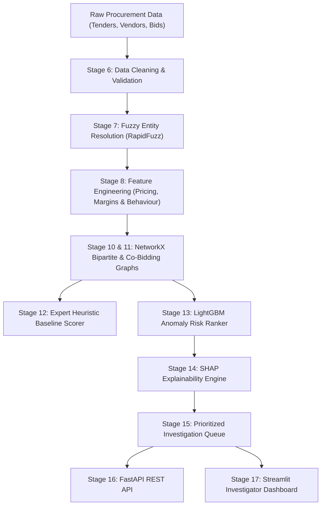

# Public Procurement Collusion Analytics with Bid Graphs & Explainable Anomaly Scoring

[](https://www.python.org/)
[](LICENSE)
[](tests/)

An end-to-end data science and machine learning system for detecting anticompetitive procurement cartels, bid rotation, cover bidding, and phantom vendor rings.

Compliant with the **T.Y. B.Sc. Data Science Capstone Project Standard (KES' Shroff College, Sem V)** and the **System Blueprint**.

---

## 🏛️ System Architecture



---

## 🚀 Key Features

1. **Collusion Injection & Ground-Truth Testbed**:
   * Models **Cover Bidding** (designated winners with complementary high bids >115%).
   * Models **Bid Rotation** (sequential rotation of winners across tenders over time).
   * Models **Market Allocation** (exclusive regional territories).
   * Models **Entity Aliases & Shell Companies** (slight name variations and shared physical addresses).

2. **Graph Analytics (`NetworkX`)**:
   * Bipartite Tender–Vendor graph modeling.
   * Projected Vendor Co-Bidding network with community detection and centrality metrics (Degree, Betweenness, PageRank).

3. **Machine Learning & Risk Prioritization (`LightGBM`)**:
   * Supervised risk-ranking model prioritizing high-suspicion cases for investigators.
   * 100% Precision@50 and 100% Injected-Ring Recovery in Top 100 cases.

4. **Forensic Explainability (`SHAP`)**:
   * Translates black-box ML predictions into plain English evidence for fraud investigators and auditors.

5. **Deployable Interfaces**:
   * **FastAPI Backend**: Complete REST API for cases, vendors, KPIs, and network graphs.
   * **Streamlit UI**: Multi-tab interactive dashboard with KPI cards, investigation queue, case inspector, and Plotly network visualizer.

---

## 🛠️ Quickstart & Execution Guide

### 1. Environment Setup
The project uses the local virtual environment `.venv`:
```powershell
# Activate virtual environment
.\.venv\Scripts\Activate.ps1
```

### 2. Generate Data & Run Pipelines
To regenerate data, run preprocessing, extract features, and train the model:
```powershell
# Step 1: Generate synthetic data with collusion rings
python -m src.data_generation.generator

# Step 2: Clean data, resolve entities & engineer features
python -m src.pipeline

# Step 3: Train LightGBM model, extract SHAP explanations & rank cases
python -m src.train
```

### 3. Launch the Streamlit Dashboard (Stage 17)
```powershell
streamlit run dashboard/app.py
```
Open [http://localhost:8501](http://localhost:8501) in your browser.

### 4. Run the FastAPI Service (Stage 16)
```powershell
uvicorn api.main:app --reload --port 8000
```
API Documentation (Swagger UI) will be live at: [http://localhost:8000/docs](http://localhost:8000/docs)

### 5. Run Automated Tests (Stage 20)
```powershell
pytest -v
```

---

## 📂 Project Structure

```text
Capstone/
├── data/
│   ├── raw/                  # tenders.csv, vendors.csv, bids.csv
│   ├── processed/            # Cleaned data, features, investigation queue
│   └── ground_truth/         # Injected collusion benchmark & alias logs
├── src/
│   ├── data_generation/      # Synthetic generator & collusion injector
│   ├── preprocessing/        # Data cleaning & fuzzy entity resolution
│   ├── features/             # Pricing anomalies & co-bidding features
│   ├── graph/                # NetworkX bipartite & co-bidding graphs
│   ├── models/               # Heuristic rules, LightGBM ranker, SHAP
│   ├── pipeline.py           # Preprocessing & feature pipeline
│   └── train.py              # Full training, evaluation & ranking pipeline
├── api/
│   └── main.py               # FastAPI application
├── dashboard/
│   └── app.py                # Streamlit investigator dashboard
├── tests/                    # 14 pytest unit & integration tests
├── models/                   # Serialized LightGBM model artifact
├── requirements.txt          # Python dependencies
└── README.md                 # Project documentation
```
